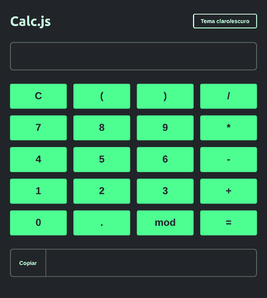
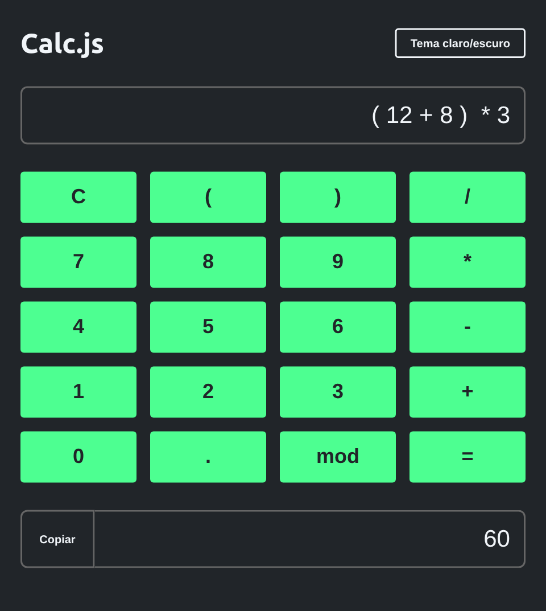
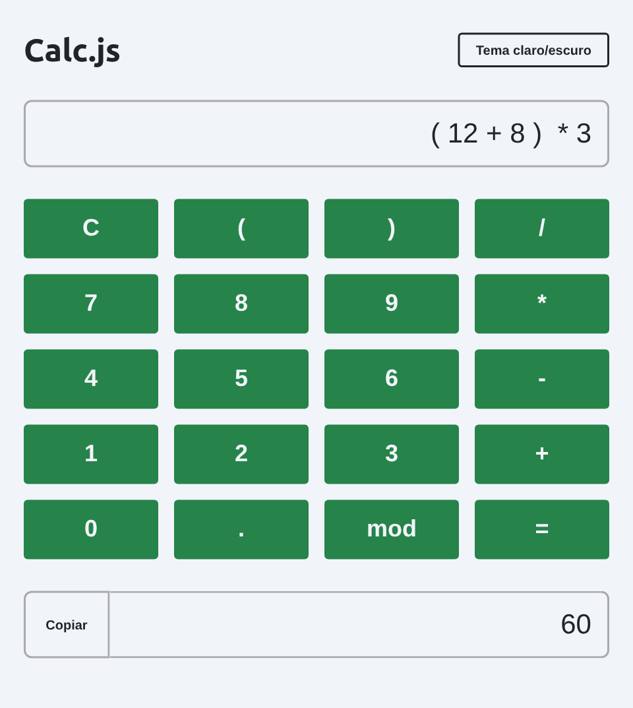

# Calc.js

Calculadora feita com **HTML, CSS e JavaScript puro**, com teclado na tela, digitação pelo teclado, botão para copiar o resultado e alternância entre tema claro e escuro.

🔗 **Demo:** [evssousa.github.io/calc-js](https://evssousa.github.io/calc-js/)

<p align="center">
  
</p>

## Funcionalidades

- Operações de soma, subtração, multiplicação, divisão e resto (`mod`)
- Suporte a **parênteses** e números decimais, respeitando a ordem das operações
- Funciona com os **botões da tela** ou com o **teclado** (`Enter` calcula, `Backspace` apaga)
- Botão **C** para limpar a conta
- Botão **Copiar** para levar o resultado para a área de transferência
- Mensagem `ERROR` quando a conta é inválida
- **Tema claro e escuro**, alternado por um botão
- Layout que se adapta a telas pequenas

<p align="center">
  
  
</p>

## Tecnologias

- **HTML5**: estrutura da calculadora
- **CSS3**: Grid para o teclado, Flexbox no cabeçalho e **variáveis CSS** para os temas
- **JavaScript (puro)**: eventos de clique e de teclado, manipulação do DOM e API de área de transferência (`navigator.clipboard`)
- **[Google Fonts (Ubuntu)](https://fonts.google.com/specimen/Ubuntu)**: tipografia
- **GitHub Pages**: hospedagem

## Estrutura do projeto

```
calc-js/
├── img/
│   ├── preview.gif           # animação usada neste README
│   ├── preview-escuro.png    # print do tema escuro
│   └── preview-claro.png     # print do tema claro
├── index.html                # estrutura da página
├── style.css                 # estilos e variáveis de cor
├── script.js                 # lógica da calculadora e troca de tema
└── README.md
```

## Como rodar localmente

Clone o repositório e abra o arquivo no navegador:

```bash
git clone https://github.com/evssousa/calc-js.git
cd calc-js
```

Depois, abra o `index.html` no navegador (duplo clique no arquivo ou, no VS Code, use a extensão Live Server).

## Como funciona

1. Cada botão numérico ou de operação guarda o seu valor em um atributo `data-value`. Ao clicar, o `script.js` acrescenta esse valor ao campo de entrada. As operações levam espaços ao redor (` + `) para a conta ficar legível.
2. No teclado, o campo só aceita as teclas da lista `allowedKeys`; qualquer outra é bloqueada com `preventDefault()`.
3. A função `calculate()` avalia a expressão e mostra o resultado. Se a avaliação falhar, o campo continua mostrando `ERROR`, em vermelho.
4. O tema claro/escuro funciona trocando os valores das variáveis CSS (`--bg-color`, `--font-color`, `--primary-color`...) na raiz da página, então todos os componentes mudam de cor juntos.

## Ideias de melhorias futuras

- Trocar o `eval()` por um avaliador de expressões próprio, mais seguro
- Lembrar o tema escolhido com `localStorage`
- Respeitar o tema do sistema com `prefers-color-scheme`
- Botão de apagar o último caractere na tela (hoje só existe no teclado)
- Histórico das últimas contas
- Avisos de acessibilidade (`aria-label` nos botões)

## Autor

Feito por **Everson Sousa**

[](https://github.com/evssousa)
[](https://linkedin.com/in/evssousa)
